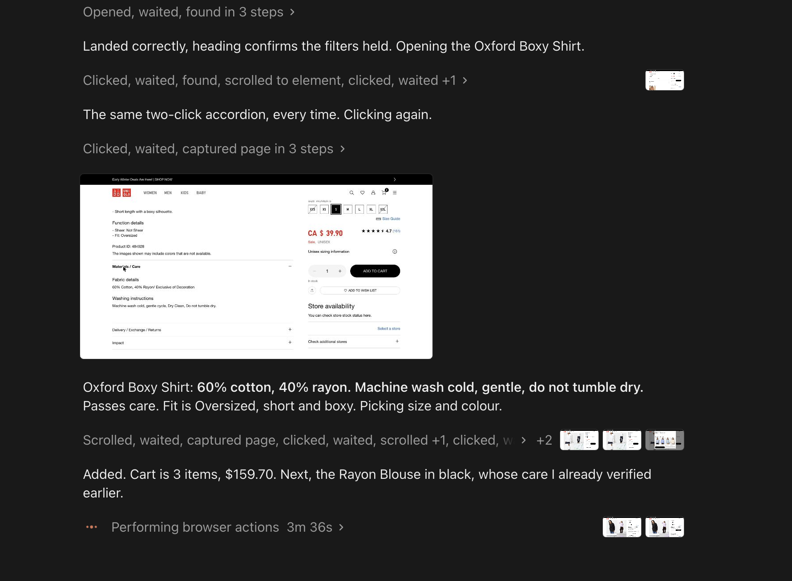

# Personal shopper

Hello! Welcome!

This is an agent skill that shops for clothes like a stylist would, plus some tests to
validate the skill.

**Read [`SKILL.md`](SKILL.md) first. That file is the product.**

## Why I built it

A Canadian womenswear brand has been promoting styling appointments all over my social
media. The idea is good: someone pulls the clothes for you and saves you working through
the store.

However, as I read more into it, more things concerned me, and it turns out I am not
alone. Other clients
[had genuine concerns too](https://www.reddit.com/r/Aritzia/comments/1st3isn/personal_styling_appointment/).

Three reasons, and two of them are just me.

- **The first is laziness.** I like shopping online, but I do not like scrolling. I shop
  in batches, and working through entire catalogues usually takes me hours, and I often
  end up with decision fatigue.
- **The second is what the product exists to fix.** With a real stylist next to you, you
  are not refusing a clothing item. You are refusing the person who chose it for you.
  Those are two different things to turn down. Refusing something they picked out for you
  feels like a personal rejection rather than a judgement about the product.
- **The third is the hardest to admit.** Someone has spent an afternoon on you, and the
  pull runs towards spending more, not less. Nobody states a number, but you feel one. I
  do not like being in that position, and I do not think most people do, which is exactly
  why it is hard to say out loud.

So that is what the skill is for. Filters narrow the range, but you still have to look
through what survives them, which is the part a stylist was meant to take off your hands.
What does not scale is saying no four times to someone who is trying to help. Information
was never the bottleneck. Permission to change your mind was.

I cannot prove any of this with big numbers. What I have is my own experience, threads of
strangers describing the same thing, and a mechanism that explains why the friction is
social rather than informational. That is enough to justify building it for myself. It is
not enough to claim it is a market. But this is the shape of personalized shopping agent
I would hope to see: it knows your size and taste across stores, hands you the exit
first, and never makes you feel you owe it a purchase.

## What it does differently

Four rules follow from that, and they are the ones I care about holding:

- **Hands you the exit first.** You are told up front you can type your own answer or say
  "that's enough" ([`SKILL.md:39`](SKILL.md#L39)). A question is only optional if refusing
  it is free, and a person in front of you cannot make it free.
- **Reads what you deleted from the cart instead of asking why**
  ([`SKILL.md:325`](SKILL.md#L325)). People justify stated preferences. Nobody justifies a
  delete, which is what makes it better evidence.
- **Asks sizes and care once, never again.** Repeat trips reach the store in three
  exchanges instead of seven ([`SKILL.md:23`](SKILL.md#L23)).
- **Stops at the cart, never checks out** ([`SKILL.md:223`](SKILL.md#L223)). A cart is
  reversible, so it costs you nothing to undo and I stay the one who says yes and pays.

**It is not tied to one store.** It reads the page in front of you and deliberately does
not crawl or fetch ([`SKILL.md:11`](SKILL.md#L11)), which is why it still works on stores
that block automated access. Uniqlo, Skims, Victoria's Secret, anything I can open.

## What it actually checks

The small things, which are most of the value. Each one is a call a stylist next to you
cannot easily make, or a fact nobody reads out loud in a fitting room.

- **Care is a hard filter, not a preference** ([`SKILL.md:55`](SKILL.md#L55)). Asked up
  front, because "machine wash only" rules out most wool and cashmere before a slot is wasted.
- **Opens the collapsed details drawer and reads it off the screen**
  ([`SKILL.md:496`](SKILL.md#L496)). On some stores that content sits outside the main
  page element, so text extraction never sees the care label at all.
- **Knows "easy care" quietly breaks** ([`SKILL.md:513`](SKILL.md#L513)). Cashmere, silk
  and most wool are hand wash or dry clean whatever the label hopes.
- **Costs dry-clean-only rather than just noting it.** Flagged as more expensive than its
  price tag.
- **Six checks in a fixed order, stopping at the first hard failure.** Hard no's, fibre
  and care, cut, colour, price, availability and returns.
- **Takes the cut from the store's own word, not the photo**
  ([`SKILL.md:178`](SKILL.md#L178)). Calibrated against the model's listed height and size.
- **Reads each store's own size chart** instead of carrying one translation between shops.
- **Picks the real size and colourway** ([`SKILL.md:216`](SKILL.md#L216)), so the cart row
  is something you can actually check out.
- **Separates verified from shortlisted** ([`SKILL.md:319`](SKILL.md#L319)). Says which it
  opened and which are guesses off the grid.
- **Asks which city, never an address.** Climate decides fabric weight and layering.
- **Asks when you need it to arrive** as soon as a date or an event comes up.
- **Every verdict is buy, skip or ask**, with one line of reasoning and what would change it.

### What that looks like in practice



A real run against Uniqlo. It opens the `Materials / Care` accordion, which takes two
clicks because the first one does not register, reads 60% cotton and 40% rayon and
"machine wash cold, gentle cycle, do not tumble dry" off the screen rather than from
extracted text, judges that against the brief, picks the size and colour, and adds it.
The last line is the part I like: it moves to the next item and notes it had already
verified that one's care earlier, so it does not open the same drawer twice.

There is also a written worked example in [`SKILL.md`](SKILL.md), run against a different
store: a $235 cashmere hoodie that passes on colour and cut and fails on hand wash and
price, with the alternative it suggests marked as unverified because that care label had
not been opened yet.

**What it does not do** ([`SKILL.md:583`](SKILL.md#L583)): it cannot tell you which store
to open. Comparing across shops means reading many catalogues at once and most retailers
block that. Discovery stays with you, and this handles everything after you land.

## Trying it yourself

The repo root is the skill directory. For Claude Code:

```
git clone https://github.com/Yueyaoxiao19/personal-shopper-evals.git
mkdir -p ~/.claude/skills/personal-shopper
cp -R personal-shopper-evals/SKILL.md \
      personal-shopper-evals/references \
      personal-shopper-evals/scripts \
      ~/.claude/skills/personal-shopper/
```

Then say something a shopper would say. You do not need to name the skill, it should pick
up on the phrasing by itself. Copy any of these to start:

**A first trip, where it knows nothing about you**

> I need new work trousers, nothing fancy, just something I can wear to the office a few
> days a week. Can you help me pick some out?

This is the one that shows the opening brief. Expect questions before you see clothes.

**A returning shopper, where it should not ask twice**

> I'm back! You already have my sizes and my care preferences from last time. I need a
> sweater or two for the office, maybe $250 for both. Let's look at Uniqlo.

Watch whether it re-asks anything you just told it. It should carry the profile forward
and say out loud what it is carrying.

**A specific store, with constraints up front**

> I'm looking for tailored trousers on Aritzia, mid rise, straight leg, ideally under
> $200. Can you find me some?

This one tests whether it moves through the store's own menus and filters rather than
guessing at category URLs.

**A single item, for a verdict rather than a search**

> Paste any product link and ask: is this worth buying?

You should get a buy, skip or ask verdict with the reason, not a description of the page
you are already looking at.

**An occasion, with a deadline**

> I have a wedding in three weeks and nothing to wear. Help me find something.

Tests whether it asks about delivery time before it shows you anything that cannot arrive
in time.

**A whole-wardrobe batch**

> The season is changing and I want to refresh my work wardrobe. Where do we start?

The batch case, which is the one I actually built this for.

It reads a store page in a browser it can see, so give it one. I have only run it in
Claude Code myself.

## What is here

| Path | What it is |
|---|---|
| [`SKILL.md`](SKILL.md) | The skill. Start here |
| [`references/`](references/) | The question bank |
| [`scripts/`](scripts/) | Builds the shortlist image, one card per garment |
| [`evaluation/cases/`](evaluation/cases/) | Three test cases generated by Claude's skill-creator, one grader file per assertion |
| [`evaluation/runs/`](evaluation/runs/) | Gradings with evidence, timings, transcripts, benchmark |
| [`evaluation/previous-versions/`](evaluation/previous-versions/) | The comparison arm |
| [`evaluation/viewer/`](evaluation/viewer/) | Skill-creator tooling, not my code |

Open any `grading.json` for per-assertion evidence, which is more useful than the score.

## What I cannot claim

- **It works for me, and that is one person.** No users, no data that it scales, and I
  would rather say so than imply otherwise.
- **I did not write the evals.** The three cases, the grader assertions and the analysis
  notes in `benchmark.json` were all generated by Claude's skill-creator. What is mine is
  the skill, the decision to test it at all, and the choice to keep a result that showed
  nothing rather than quietly drop it.
- **Re-running the evals needs the skill-creator harness**, which is not in this repo. You
  can read the tests but not execute them from a clean clone.
- **The eval persona is synthetic.** Sizes, height and care values are invented, chosen to
  be specific enough to test whether they get re-asked. No real personal data is here.

Happy shopping :)))
